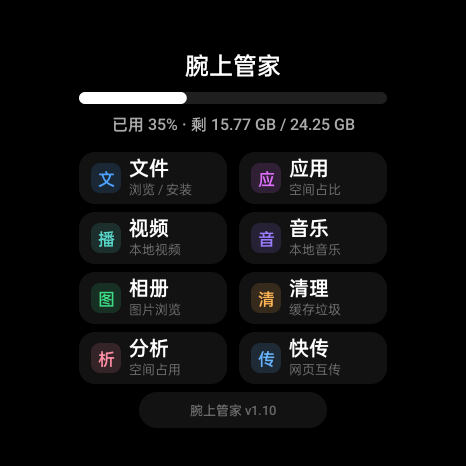
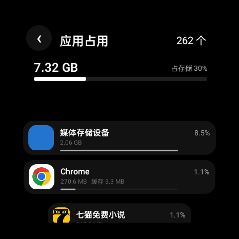
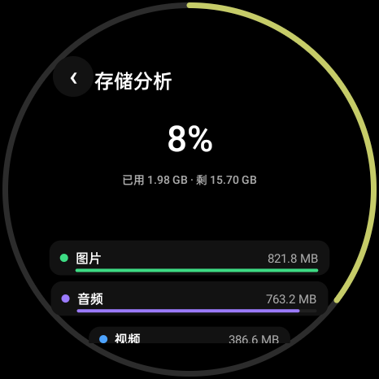
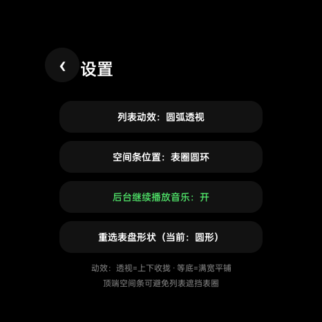

# WatchSuite · 腕上管家

一款为**智能手表**打造的本地工具合集：纯 Java + Canvas 手绘界面，零第三方依赖，不联网、无广告。

<p align="center">
  
  
  
  
</p>

## 特性

- **表圈空间圆环**：主界面和各统计页把存储紧张度画成一圈绕表圆环，绿 → 黄 → 红 随占用率渐变；纯装饰不抢触摸，右滑返回手感不受影响。可在设置里改为「固定最上端」的细横条，避免列表滑动时视觉干扰
- **两种列表动效**（方圆表互通，随意切换）：圆弧透视（上下两端收拢聚焦）/ 等底信息流（满宽平铺）
- **侧边旋钮/表冠支持**：转动表冠直接滚动列表（应用/文件/音乐/视频/清理/分析全部页面），滚动事件走标准旋转输入，任何带旋钮的手表通用
- **方 / 圆双布局层**：圆表 2 列磁贴、方表 3 列磁贴（3+3+2），各自独立排版，一套代码自动适配
- **圆盘转场**：子页面像一块实心圆盘从侧面滑入；主界面在空白处一划即整盘滑出回表盘
- **媒体会话接入**：播放音乐时系统把应用识别为媒体应用——表盘出现媒体卡片、通知栏三按钮（上一首 / 暂停 / 下一首），任何界面随时可控暂停
- **WMA 自动转码**：WMA 音频播放时自动用内置 FFmpeg 转码（带缓存，转一次后续直接秒开），转码完成后列表即显示时长
- **帧率自适配**：自动请求同分辨率下的最高刷新率
- **零第三方框架依赖**：界面全部 Canvas 手绘，仅音频转码内置 FFmpegKit

## 八个模块

| 模块 | 说明 |
|---|---|
| 文件 | 目录浏览、两级加载（先出目录再算体积）、打开 / 安装 / 分享 / 删除 |
| 应用 | 已装应用列表与存储占用排行（安装包 / 数据 / 缓存拆解，支持系统详情直达） |
| 视频 | 扫描本机视频，内置播放器（双指缩放 / 拖动 / 进度条） |
| 音乐 | 本地音乐扫描播放、可拖进度条、上下首切换、WMA 自动转码、后台续播开关、媒体会话控件 |
| 相册 | 图片网格浏览、全屏查看 |
| 清理 | 缓存与垃圾文件扫描清理 |
| 分析 | 存储分类统计 + 大文件 TOP5，全盘占用表圈指示 |
| 快传 | 局域网 HTTP 传输，手机浏览器直接访问手表收发文件 |

> 设置入口在「关于」页：列表动效、空间条位置、后台续播、表盘形状。

## 版本号规则

三段式 `X.Y.Z`：**Y = 新功能 +1，Z = 修 bug +1**；versionCode 独立连续递增。当前 **v2.2.0**。

## 关于「读取应用列表」权限

部分国产 ROM（OPPO / 一加 / 真我 等）会在应用枚举已安装应用时弹窗询问。本项目会把读取结果连同图标一起缓存到本地，**12 小时内不再触碰相关系统接口**，因此正常情况下大退重进不会再被询问。

## 构建

需要 JDK 17+、Android SDK（compileSdk 35）。

```bash
git clone https://github.com/muqiu128/WatchSuite.git
cd WatchSuite
# 在 local.properties 里写 sdk.dir=你的 Android SDK 路径
./gradlew assembleDebug
```

产物：`app/build/outputs/apk/debug/app-debug.apk`

## 安装

```bash
adb install -r app-debug.apk
```

首次进入需授予存储权限（部分 ROM 还需「读取应用列表」与「使用情况访问」权限，用于统计应用占用）。

## 兼容性

- Android 8.0（API 26）及以上
- 一加手表 2（OPWW234，466×466 圆表）实机验证；任意分辨率圆表、方表均可运行

## 隐私

不联网（仅「快传」在你主动开启时绑定局域网端口）、不上传任何数据、无追踪、无广告。

## License

MIT
