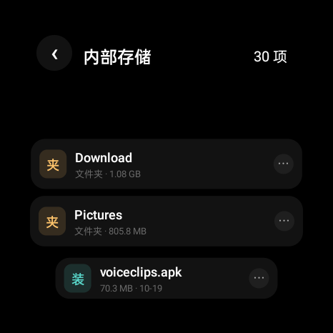

# WatchSuite · 腕上管家

一款为**圆形智能手表**打造的本地工具合集：纯 Java + Canvas 手绘界面，零第三方依赖，不联网、无广告，APK 仅 ~81KB。

<p align="center">
  
  
  
</p>

## 特性

- **圆盘转场**：子页面像一块实心圆盘从侧面滑入，黑底与内容同步移动；主界面同样是一块圆盘，在空白处一划即整盘滑出回表盘
- **层叠卡片流**：列表项离屏幕中心越远越窄、越小，滚动时自然聚焦
- **全分辨率适配**：UI 全部按 466×466 逻辑坐标绘制，按 `min(w,h)/466` 整体缩放，任意圆表自动适配；首次启动可切换方表模式（转场面板变圆角矩形）
- **帧率自适配**：自动请求同分辨率下的最高刷新率
- **零依赖**：不用任何第三方库，几乎全部界面为 Canvas 手绘

## 八个模块

| 模块 | 说明 |
|---|---|
| 文件 | 目录浏览、两级加载（先出目录再算体积）、打开 / 安装 / 分享 / 删除 |
| 应用 | 已装应用列表与存储占用排行（安装包 / 数据 / 缓存拆解） |
| 视频 | 扫描本机视频，内置播放器（双指缩放 / 拖动 / 进度条） |
| 音乐 | 本地音乐扫描播放、可拖进度条、上下首切换、显示时长（关闭播放页即停止） |
| 相册 | 图片网格浏览、全屏查看 |
| 清理 | 缓存与垃圾文件扫描清理 |
| 分析 | 存储分类统计 + 大文件 TOP5 |
| 快传 | 局域网 HTTP 传输，手机浏览器直接访问手表收发文件 |

> 音乐目前是「打开播放页才播放、关掉就停」，不会在后台继续出声。后台续播以后会做成开关。

## 关于「读取应用列表」权限

部分国产 ROM（OPPO / 一加 / 真我 等）会在应用枚举已安装应用时弹窗询问。本项目会把读取结果连同图标一起缓存到本地，**12 小时内不再触碰相关系统接口**，因此正常情况下大退重进不会再被询问。

## 构建

需要 JDK 17+、Android SDK（compileSdk 35）。

```bash
git clone https://github.com/<your-name>/WatchSuite.git
cd WatchSuite
# 在 local.properties 里写 sdk.dir=你的 Android SDK 路径
./gradlew assembleDebug
```

产物：`app/build/outputs/apk/debug/app-debug.apk`

## 安装

```bash
adb install -r app-debug.apk
```

首次进入需授予存储权限（部分 ROM 还需「读取应用列表」与「使用情况访问」权限，用于统计应用占用）。

## 兼容性

- Android 8.0（API 26）及以上
- 一加手表 2（OPWW234，466×466）实机验证；任意分辨率圆表、方表均可运行

## 隐私

不联网（仅「快传」在你主动开启时绑定局域网端口）、不上传任何数据、无追踪、无广告。

## License

MIT
